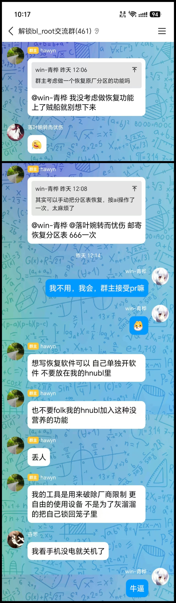

# hnubl 恢复助手

独立的 Android 恢复工具，包名为 `wm.honor8e5restore`。用于撤销指定设备上的假回锁及相关启动分区修改，不是通用 BL 解锁工具，也不是 hnubl 的官方功能或官方模块。

## 原作者与项目关系

原 hnubl 项目及作者主页：

- [hawyn2018/honor_8e5_ubl](https://github.com/hawyn2018/honor_8e5_ubl)

原作者明确表示不考虑恢复功能，并建议有需要的用户独立开发，不要把恢复功能放进 hnubl 或 fork 后加入。截图中的原话包括：

> 想写恢复软件可以 自己单独开软件 不要放在我的hnubl里

因此，本项目采用独立应用、独立源码仓库的形式。原项目及作者不参与本恢复工具的开发，也不为其提供背书。



感谢原作者及原项目提供的分区研究基础，也感谢 BusyBox、Miuix、AndroidX、Kotlin 等第三方项目的贡献者。

## 主要功能

- 按实际 OTA 次数分步导入备份：0 次、1 次或多次。
- 多次 OTA 时，使用最近两次备份优先恢复双槽；缺少倒数第二次备份时，明确确认风险后仅恢复当前槽。
- 校验备份文件、清单、镜像长度和 SHA-256，拒绝损坏或不完整的输入。
- 恢复前 ZIP 同时校验整份字节、ZIP 结构、必需条目及逐文件内容。
- 写入前停止 OTA 配套服务并确认退出，使用事务锁防止并发恢复。
- 首次写入前持久化中断标记；写入完成后重新扫描，未通过则要求人工复核。
- GPT 仅删除 `efisp` 并恢复原始 `userdata` 末端，保留当前分区类型、GUID 和 A/B 属性。

App 不格式化 `userdata`、不主动扩大 F2FS、不切换槽位、不自动重启、不修改 OEMINFO/DeviceInfo，也不执行官方回锁。

## 构建要求

- JDK 17。
- Android SDK 37 和 Build Tools 37.0.0。
- 包含 `aarch64-linux-android28-clang` 的 Android NDK。
- 可访问 Gradle 发行版和 Maven 依赖仓库的网络环境。

项目附带 Gradle 9.5.0 wrapper。首次构建时，wrapper 会按 `gradle/wrapper/gradle-wrapper.properties` 下载对应发行版。网络不可用时，可将 `distributionUrl` 改为本机已有的 Gradle 9.5.0 ZIP 路径，或直接使用已安装的 Gradle 执行相同任务。

设置 SDK 路径：

```bash
export ANDROID_HOME=/path/to/Android/Sdk
```

也可通过 `ANDROID_NDK_HOME` 指定 NDK，否则构建脚本从 SDK 的 `ndk` 目录选择。

## 构建

在项目根目录执行：

```bash
./gradlew :restore-core:test :restoreapp:assembleRelease
```

Windows CMD 可使用：

```bat
gradlew.bat :restore-core:test :restoreapp:assembleRelease
```

输出文件：

- Release：`restoreapp/build/outputs/apk/release/restoreapp-release.apk`
- Debug：`restoreapp/build/outputs/apk/debug/restoreapp-debug.apk`
- Android 测试包：`restoreapp/build/outputs/apk/androidTest/debug/restoreapp-debug-androidTest.apk`

Debug 构建设置 `ALLOW_PARTITION_WRITES=false`，只允许只读诊断。Release 允许分区写入，不应仅为了测试界面而直接执行恢复。

## Release 签名

没有配置签名时，Release 使用 debug 签名并显示警告，不应用于正式发布。个人发布签名必须从项目外部加载，不要提交私钥或密码。

在 `~/.gradle/gradle.properties` 中指定自己的配置文件：

```properties
PERSONAL_SIGNING_PROPERTIES=/path/to/private/key.properties
```

配置文件示例（请放在仓库外）：

```properties
storeFile=/path/to/private/release.jks
storePassword=本机私密密码
keyAlias=你的密钥别名
keyPassword=本机私密密码
```

`PERSONAL_SIGNING_PROPERTIES` 也可以直接作为环境变量设置：

```bash
export PERSONAL_SIGNING_PROPERTIES=/path/to/private/key.properties
```

如果 `storeFile` 使用相对路径，构建脚本会先尝试相对于配置文件所在目录解析。也可以用环境变量显式覆盖密钥库位置：

```bash
export PERSONAL_SIGNING_STORE_FILE=/path/to/private/release.jks
```

验证 APK：

```bash
"$ANDROID_HOME/build-tools/37.0.0/apksigner.bat" verify --verbose --print-certs \
  restoreapp/build/outputs/apk/release/restoreapp-release.apk
```

同一包名升级时必须保持签名一致。更换签名后，Android 会要求先卸载旧版本；卸载会删除旧 App 内部的导入副本，但不会删除 `Download` 中的原备份。

## 测试

### JVM 与构建测试

```bash
./gradlew :restore-core:test \
  :restoreapp:testDebugUnitTest \
  :restoreapp:assembleDebug \
  :restoreapp:assembleDebugAndroidTest \
  :restoreapp:assembleRelease
```

### 主机原生测试

需要 Python 3 和支持 C11 的 `clang`。测试只使用临时普通文件，不访问块设备：

```bash
python tests/native/test_gpttool_range.py
python tests/native/test_gpttool_fuzz.py
python tests/native/test_partition_worker_restore.py
```

`CC` 环境变量可指定编译器。

以下目录默认被 `.gitignore` 排除，用于放置你自己的真实备份夹具：

- `ublbackup_*/`
- `hnubl_ota_backup_*/`

这些目录可能包含设备特定数据，不应直接提交。缺少可选真实夹具时，相关测试会自动跳过；其余测试仍可运行。

### Android 仪器测试

```bash
adb install -r restoreapp/build/outputs/apk/debug/restoreapp-debug.apk
adb install -r restoreapp/build/outputs/apk/androidTest/debug/restoreapp-debug-androidTest.apk
adb shell am instrument -w -r \
  wm.honor8e5restore.debug.test/androidx.test.runner.AndroidJUnitRunner
```

事务测试需要 Root，但只使用 `/data/local/tmp` 下的独立测试目录和测试进程，不接触真实 OTA 进程或真实恢复分区。

## 备份选择逻辑

1. 首先选择假回锁后的实际保锁 OTA 次数。
2. `0 次`：只导入假回锁前的干净备份。
3. `1 次`：先导入干净备份，再导入最后一次保锁 OTA 备份。
4. `多次`：完成上述备份后，确认是否有倒数第二次备份：
   - 有：导入倒数第二次备份，优先恢复双槽。
   - 没有：明确确认另一槽和后续 OTA 风险后，仅恢复当前槽。
5. 完成分步导入后，才能进行只读设备检查。

`Download/hnubl` 中的 OTA 目录数量只作辅助核对。备份可能被删除、移动或重复，真实次数以及“最后一次/倒数第二次”的选择仍由用户负责。

## 安全边界与限制

- 只处理恢复计划需要的 ABL、init_boot、OTA 前级分区和 GPT。
- 分区写入前必须停止 OTA 配套服务并取得事务锁，停止失败即中止。
- 恢复前备份必须通过整份 ZIP 和逐条内容校验，校验失败不得开始写入。
- 恢复完成后必须重新扫描，只有所有待恢复项目都消失才显示完成。
- ABL 防回滚检查读取镜像声明值，不等于读取设备熔丝或 RPMB。
- 镜像是否来自可信官方来源、是否与当前系统匹配，仍需用户确认。
- 断电、其他工具并发修改、错误备份和不兼容镜像仍可能导致启动失败。

出现部分写入后不要盲目重启或重复执行，应保留恢复前备份并先核验当前状态。项目验证使用临时文件、模拟故障和只读设备检查，未在真实设备上执行恢复写入。

手工恢复背景记录见 [restore-fake-lock-recovery-guide.md](docs/restore-fake-lock-recovery-guide.md)。

## 许可证与致谢

项目根目录保留原项目的 [LICENSE](LICENSE)。

第三方组件通知见 [THIRD-PARTY-NOTICES.txt](third_party/THIRD-PARTY-NOTICES.txt)。BusyBox 使用 GPL-2.0，许可证和对应源代码、补丁材料位于 `third_party/toolchain/`。

原作者仓库：<https://github.com/hawyn2018/honor_8e5_ubl>。
